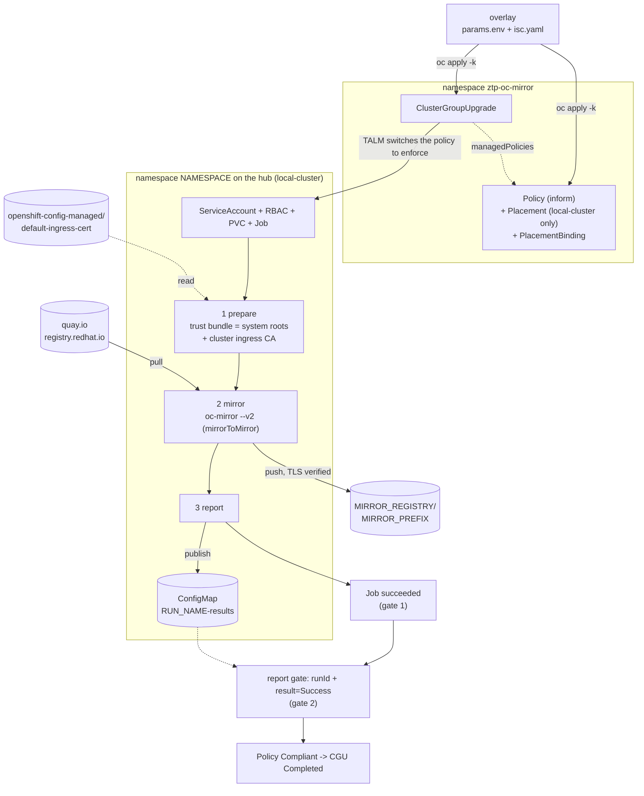

# oc-mirror-cgu

Mirror OpenShift releases, operator catalogs and additional images into a registry **from an
ACM hub cluster, driven by GitOps primitives**. A TALM `ClusterGroupUpgrade` enforces an ACM
`Policy`. The Policy runs `oc-mirror` v2 as a Kubernetes `Job` on the hub (`local-cluster`),
with an `ImageSetConfiguration` taken from a ConfigMap. Everything is rendered with kustomize
(**base + component + overlays**). One overlay is one mirror run: a version, a spoke namespace,
a registry and a prefix.



## Why

* **No workstation, no jump host disk.** oc-mirror runs inside the hub. Images stream
  registry-to-registry, and only the small oc-mirror workspace lives on a PVC.
* **Declarative and reviewable.** The whole run is a kustomize overlay. You can put it in Git
  and render it with `oc kustomize` before anything touches the cluster.
* **Same tooling as ZTP.** Policy, Placement and CGU are the objects ZTP already uses, so
  progress, timeouts and completion show up the same way (`oc get cgu`).
* **Hub only.** The Placement selects `local-cluster` and nothing else. No spoke receives the
  policy.
* **TLS verified by default.** The cluster ingress CA is read at run time and trusted, so pushes
  to a route signed by the ingress operator verify without `--dest-tls-verify=false`.
* **Readable results.** Every run publishes `<RUN_NAME>-results`: image counts, errors, the
  generated IDMS/ITMS/CatalogSource YAML and the log tail, all via `oc get cm`.

## Requirements

| Requirement | Notes |
|---|---|
| Hub with ACM (governance add-ons on `local-cluster`) | `config-policy-controller` evaluates the policy on the hub itself |
| TALM (`topology-aware-lifecycle-manager`) | provides `ClusterGroupUpgrade` (`ran.openshift.io/v1alpha1`) |
| `local-cluster` in the `global` ManagedClusterSet | the Placement selects `name=local-cluster`, `local-cluster=true` |
| Workload namespace `NAMESPACE` exists on the hub | e.g. the spoke's cluster namespace; the ISC ConfigMap, SA, RBAC, PVC, Job and results ConfigMap go here |
| Destination route signed by the **cluster ingress CA** (for `DEST_TLS_VERIFY=true`) | true for edge/reencrypt routes using the default ingress certificate; the CA comes from `openshift-config-managed/default-ingress-cert` |
| Image with `oc` + coreutils (`CLI_IMAGE`) | used by the prepare and report stages, e.g. the `cli` component of a release payload |
| Pull secret `AUTH_SECRET` in `NAMESPACE` | `kubernetes.io/dockerconfigjson` with auths for **every source registry** in the ISC (`quay.io`, `registry.redhat.io`, …) **and the destination** |
| StorageClass `csi-cephrbd` | for the workspace PVC; change it in `base/policy.yaml` if you use another class |
| Hub egress to the sources | direct or via the cluster proxy; oc-mirror also queries the OpenShift update graph |
| `oc` ≥ 4.x with built-in kustomize | to render and apply (`oc kustomize`, `oc apply -k`) |

## Repository layout

```
oc-mirror-cgu/
├── kustomization.yaml              entry point: resources: [overlays/<default run>]
├── base/                           generic objects, UPPER_CASE placeholders (never applied alone)
│   ├── kustomization.yaml          adds label app.kubernetes.io/part-of=oc-mirror-cgu
│   ├── namespace.yaml              Namespace ztp-oc-mirror + ManagedClusterSetBinding global
│   ├── policy.yaml                 Policy (inform): oc-mirror-run → SA, PVC, Job, RBAC
│   │                                                oc-mirror-report → results gate
│   │                               + Placement oc-mirror-hub-only + PlacementBinding
│   └── cgu.yaml                    ClusterGroupUpgrade (clusters: [local-cluster])
├── components/
│   └── params/kustomization.yaml   kind: Component — replacements: params.env → base fields
└── overlays/
    ├── cwl3-sno-ocp-5.0.0-rc.7/    candidate-5.0, 5.0.0-rc.7, release only      (tested)
    │   ├── kustomization.yaml
    │   ├── params.env
    │   └── isc.yaml
    └── cwl3-sno-ocp-5.0-stable/    stable-5.0, 5.0.0–5.0.2 + 22 operators + 4 images (not run, see below)
        ├── kustomization.yaml      + patches: Job deadline 36000 s, CGU timeout 660 min
        ├── params.env
        └── isc.yaml
```

### What each object does

| Object (namespace) | Role |
|---|---|
| Namespace `ztp-oc-mirror` | Home of all root Policies, Placements and CGUs. Root policies must **not** live in a ManagedCluster namespace, because ACM replicates policies into those. |
| ManagedClusterSetBinding `global` (`ztp-oc-mirror`) | Lets the Placement select clusters of the `global` set, which includes `local-cluster` |
| ConfigMap `RUN_NAME` (`NAMESPACE`) | **Input:** `isc.yaml`, the ImageSetConfiguration of this run |
| Policy `RUN_NAME` (`ztp-oc-mirror`), `inform` | Two ConfigurationPolicies. `oc-mirror-run` describes the SA, PVC, Job and RBAC below. `oc-mirror-report` is the results gate. Inform only, so applying it creates nothing. |
| Placement `oc-mirror-hub-only` (`ztp-oc-mirror`) | Selects `local-cluster` only (shared by all runs) |
| PlacementBinding `RUN_NAME` (`ztp-oc-mirror`) | Binds the run's Policy to the Placement |
| ClusterGroupUpgrade `RUN_NAME` (`ztp-oc-mirror`) | The trigger: TALM enforces the Policy on `local-cluster`, then completes when it is Compliant |
| Job `RUN_NAME` (`NAMESPACE`), created by the Policy | Three stages on the PVC: **prepare** (`CLI_IMAGE`: CA bundle), **mirror** (`OC_MIRROR_IMAGE`: `oc-mirror --v2`, always exits 0 and persists rc), **report** (`CLI_IMAGE`: publishes the results ConfigMap, exits 1 if the mirror failed) |
| PVC `RUN_NAME` (`NAMESPACE`), created by the Policy | oc-mirror workspace: CA bundle, release metadata, catalogs, logs, generated IDMS/ITMS/CatalogSource/signatures |
| Role + RoleBinding `RUN_NAME` (`NAMESPACE`), created by the Policy | SA `oc-mirror` may **create** ConfigMaps and **get/update/patch only `<RUN_NAME>-results`** |
| Role `oc-mirror-ingress-ca-reader` + RoleBinding `RUN_NAME` (`openshift-config-managed`), created by the Policy | SA `oc-mirror` may **get only** the ConfigMap `default-ingress-cert`. Role shared by all runs, one binding per run. |
| ConfigMap `<RUN_NAME>-results` (`NAMESPACE`), written by the report stage | The run's report (see [Results ConfigMap](#results-configmap)) |

**Completion signal: two gates.**

1. `oc-mirror-run`: the Job object-template contains `status.succeeded: 1`. The field is
   compared, never written. The Job only succeeds once the report stage has published the
   results and the mirror returned 0.
2. `oc-mirror-report`: ConfigMap `<RUN_NAME>-results` must contain `runId: <RUN_NAME>` and
   `result: Success`. This gate has `extraDependencies` on `oc-mirror-run` being Compliant, so it
   is evaluated only after the Job succeeded. Without that ordering, enforce would *create* a
   missing ConfigMap with `result: Success`, a fake pass.

The Policy, and with it the CGU, completes only when both gates are Compliant.

## How the templating works

Kustomize has no variables, so values travel as data.

1. **`params.env`.** The overlay turns it into a ConfigMap `oc-mirror-params`
   (`configMapGenerator`), annotated `config.kubernetes.io/local-config: "true"`. Kustomize
   reads it at build time and **never emits it**.
2. **`isc.yaml`.** The overlay turns it into a ConfigMap `oc-mirror-isc`. The component renames
   it to `RUN_NAME` and moves it into `NAMESPACE`.
3. **`components/params`** holds `replacements` that copy each value into the base:

| `params.env` key | Rendered into |
|---|---|
| `RUN_NAME` | names of the Policy, PlacementBinding (+ `subjects[0]`), CGU (+ `managedPolicies[0]`), Job, PVC, ISC ConfigMap and the per-run Roles/RoleBindings; the Job's `config`/`work` volumes and report env; `runId` in the report gate; the 2nd quoted argument of the `fromConfigMap` and `printf "%s-results"` templates (results ConfigMap name) |
| `NAMESPACE` | `metadata.namespace` of the SA, PVC, Job, Role/RoleBinding, ISC ConfigMap and report gate; the RoleBindings' subject namespace; the 1st argument of the `fromConfigMap` annotation |
| `AUTH_SECRET` | Job volume `auth` → `secret.secretName` (mounted as `/auth/.dockerconfigjson`) |
| `OC_MIRROR_IMAGE` | image of the `mirror` stage |
| `CLI_IMAGE` | image of the `prepare` and `report` stages (needs `oc`, bash, coreutils, `/etc/pki/tls/certs/ca-bundle.crt`) |
| `MIRROR_REGISTRY`, `MIRROR_PREFIX` | env of the mirror and report stages; the Job runs `oc-mirror … docker://${MIRROR_REGISTRY}/${MIRROR_PREFIX}` |
| `DEST_TLS_VERIFY` | env → `--dest-tls-verify=${DEST_TLS_VERIFY}`; the mirror stage sets `SSL_CERT_FILE` to the prepared bundle |
| `PVC_SIZE` | PVC `spec.resources.requests.storage` |
| `VERIFY_RELEASE`, `VERIFY_CHANNEL` | not rendered; informational, for verification scripts |

Design rules:

* **One name per run.** All per-run objects share `RUN_NAME`. They are different kinds, so no
  clash, and no string concatenation is needed (replacements cannot concatenate). Keep it a
  lowercase DNS label of **≤ 40 characters**: the replicated policy is named
  `ztp-oc-mirror.<RUN_NAME>` and must stay ≤ 63.
* **Strings in `params.env`, integers in patches.** Replacements copy strings, so integer
  fields (Job `activeDeadlineSeconds` / `backoffLimit`, CGU `remediationStrategy.timeout`) are
  overridden with a JSON patch in the overlay.
* **The ISC is a whole file.** It is a string inside a ConfigMap, so kustomize cannot patch
  inside it. Changing the version, channel or packages means editing the overlay's `isc.yaml`.
* **Shared vs per-run objects.** The Namespace, ClusterSetBinding, Placement and SA `oc-mirror`
  are identical in every overlay. Everything else is per run, so several runs can coexist.
* **Stage labels.** `oc-mirror.ngc747/stage`: `01` (namespace, binding, ISC ConfigMap),
  `02` (Policy, Placement, PlacementBinding), `03` (CGU), for a staged apply with `-l`.

## Configure before use

The overlays ship with **placeholder values** in `params.env`. Set them for your environment
before applying anything:

| Key | Shipped value | Set it to |
|---|---|---|
| `NAMESPACE` | `sno` | an existing hub namespace for the workload, e.g. the spoke's cluster namespace |
| `MIRROR_REGISTRY` | `quayregistry` | the destination registry `host[:port]`, resolvable and reachable from hub pods, e.g. the Quay route |
| `MIRROR_PREFIX` | `quayadmin/ocp5-candidate`, `quayadmin/ocp5` | `<org-or-user>/<repo-prefix>` in the destination; the credential must be allowed to create repositories there |
| `AUTH_SECRET` | `disconnected-quay-registry-pull-secret` | a `kubernetes.io/dockerconfigjson` Secret **in `NAMESPACE`** with auths for every source registry in the ISC and for `MIRROR_REGISTRY` |
| `RUN_NAME` | `oc-mirror-5-0-0-rc7`, `oc-mirror-5-0-stable` | unique per run, lowercase DNS label, ≤ 40 characters |
| `OC_MIRROR_IMAGE` | 4.22.3 payload `oc-mirror` image | any oc-mirror v2 image; `oc adm release info --image-for=oc-mirror <release>` gives the payload's one |
| `CLI_IMAGE` | 4.22.3 payload `cli` image | any image with `oc`, bash and coreutils; `oc adm release info --image-for=cli <release>` |
| `DEST_TLS_VERIFY` | `true` | keep `true` when the destination route is signed by the cluster ingress CA (trusted automatically). Use `false` only for a destination with an unrelated untrusted certificate. |
| `PVC_SIZE` | `5Gi` | see [Sizing](#sizing) |

The overlay directory names (`cwl3-sno-ocp-…`) come from the lab this was built in. They are
just names, so rename or copy them freely.

## Quick start

Render first, then apply. The commands assume `KUBECONFIG` points at the hub. Load the
overlay's `params.env` into the shell so the commands below use its values:

```bash
O=overlays/cwl3-sno-ocp-5.0.0-rc.7
set -a; . $O/params.env; set +a        # RUN_NAME, NAMESPACE, MIRROR_REGISTRY, ...

oc kustomize $O                 # review: 7 objects (params ConfigMap is not emitted)
oc apply -k $O                  # everything at once   (oc apply -k . = the default overlay)
```

Staged apply, to see the inform phase before TALM enforces:

```bash
oc kustomize $O | oc apply -f - -l oc-mirror.ngc747/stage=01   # namespace, binding, ISC ConfigMap
oc kustomize $O | oc apply -f - -l oc-mirror.ngc747/stage=02   # Policy (inform), Placement, binding

oc -n ztp-oc-mirror get placementdecision -o jsonpath='{..clusterName}'   # expect: local-cluster
oc get policies -A | grep oc-mirror        # root (ztp-oc-mirror) + replica (local-cluster), NonCompliant

oc kustomize $O | oc apply -f - -l oc-mirror.ngc747/stage=03   # CGU → TALM enforces → PVC + Job
```

### Monitor

```bash
oc -n ztp-oc-mirror get cgu $RUN_NAME
oc -n $NAMESPACE get job,pod,pvc -l app.kubernetes.io/part-of=oc-mirror-cgu
POD=$(oc -n $NAMESPACE get pod -l job-name=$RUN_NAME -o name | head -1)
oc -n $NAMESPACE logs $POD -c prepare                                    # "appended cluster ingress CA"
oc -n $NAMESPACE logs -f $POD -c mirror | sed -u 's/\x1b\[[0-9;]*m//g'     # oc-mirror output
oc -n $NAMESPACE logs -f $POD -c report                                  # report summary
oc -n local-cluster get configurationpolicy oc-mirror-run oc-mirror-report   # the two gates
```

The run is done when both gates are Compliant and the CGU reports
`Succeeded=True Completed: All clusters are compliant with all the managed policies`.

### Results ConfigMap

The report stage publishes `<RUN_NAME>-results` in `NAMESPACE`. It is labelled
`app.kubernetes.io/part-of=oc-mirror-cgu`.

| Key | Contents |
|---|---|
| `runId`, `result` | `RUN_NAME` and `Success` / `Failed` / `Unknown`; what the report gate checks |
| `summary` | run id, destination, TLS verify, result, exit code, start and finish time |
| `images` | oc-mirror's own `=== Results ===` counts (`x / y release images mirrored successfully`, operators, additional images) |
| `files` | `ls -l` of the generated `cluster-resources/` |
| `clusterResources` | generated IDMS / ITMS / CatalogSource / ClusterCatalog YAML inline (signature ConfigMap omitted, capped at 250K) |
| `errors` | `working-dir/logs/mirroring_errors_*.txt` (first 20 KB) or `none` |
| `logTail` | last 20 KB of the oc-mirror log (ANSI and non-ASCII stripped) |

```bash
oc -n $NAMESPACE get cm ${RUN_NAME}-results \
  -o go-template='{{index .data "summary"}}{{index .data "images"}}{{"\n"}}errors: {{index .data "errors"}}{{"\n"}}'
oc -n $NAMESPACE get cm ${RUN_NAME}-results -o go-template='{{index .data "clusterResources"}}'
```

A failed mirror still produces the ConfigMap (`result: Failed` plus the `errors` and `logTail`
keys). The report stage then exits 1, so the Job fails and the CGU does not complete.

### Verify the mirror

```bash
umask 077; A=$(mktemp)
oc -n $NAMESPACE get secret $AUTH_SECRET \
  -o jsonpath='{.data.\.dockerconfigjson}' | base64 -d > $A
oc adm release info -a $A --insecure=true \
  $MIRROR_REGISTRY/$MIRROR_PREFIX/openshift/release-images:${VERIFY_RELEASE}-x86_64
rm -f $A
```

Compare the digest with the upstream payload of the same version in the OpenShift update graph:

```bash
curl -s -H 'Accept: application/json' \
  "https://api.openshift.com/api/upgrades_info/v1/graph?channel=${VERIFY_CHANNEL}&arch=amd64" |
  python3 -c "import json,sys; print([n['payload'] for n in json.load(sys.stdin)['nodes'] if n['version']=='${VERIFY_RELEASE}'])"
```

### Generated cluster resources

oc-mirror writes `ImageDigestMirrorSet`, `ImageTagMirrorSet`, the signature ConfigMap and,
for operator catalogs, `CatalogSource` / `ClusterCatalog` manifests into
`/work/ws/working-dir/cluster-resources/` on the PVC. The same YAML (except the signature
ConfigMap) is in the `clusterResources` key of `<RUN_NAME>-results`. Copy the signature ConfigMap
off the PVC if you need it.

They are **not applied anywhere**. They are what a cluster consuming this mirror needs.

## Adding a run (other version, spoke namespace, registry or prefix)

```bash
cp -r overlays/cwl3-sno-ocp-5.0.0-rc.7 overlays/<spoke>-ocp-<version>
$EDITOR overlays/<spoke>-ocp-<version>/params.env   # RUN_NAME (unique), NAMESPACE, AUTH_SECRET,
                                                    # OC_MIRROR_IMAGE, MIRROR_REGISTRY, MIRROR_PREFIX, ...
$EDITOR overlays/<spoke>-ocp-<version>/isc.yaml     # channels, min/maxVersion, operators, additionalImages
oc kustomize overlays/<spoke>-ocp-<version>         # review
```

For large ISCs (many operators or versions), raise the Job deadline and CGU timeout with
patches, as `overlays/cwl3-sno-ocp-5.0-stable/kustomization.yaml` does:

```yaml
patches:
  - target: {kind: Policy}
    patch: |-
      - op: replace
        path: /spec/policy-templates/0/objectDefinition/spec/object-templates/2/objectDefinition/spec/activeDeadlineSeconds
        value: 36000
  - target: {kind: ClusterGroupUpgrade}
    patch: |-
      - op: replace
        path: /spec/remediationStrategy/timeout
        value: 660          # minutes, keep > Job deadline
```

To change the ISC of a run that already ran, give it a **new `RUN_NAME`**. Job templates are
immutable, and a CGU runs once. The policy also flags drift: the Job's pod carries a base64
fingerprint of the ISC it was created from (`oc-mirror.ngc747/isc-b64`). If the ConfigMap
changes afterwards, the policy turns NonCompliant.

### Validate an ISC before running it

A failing dry-run costs seconds. A failing Job costs a CGU timeout. Run oc-mirror with
`--dry-run`, using the same image, secret and ISC, in a throwaway pod in `NAMESPACE`. With the
overlay's `params.env` loaded (see [Quick start](#quick-start)), the heredoc fills in the values:

```bash
oc -n $NAMESPACE create configmap isc-dryrun --from-file=isc.yaml=$O/isc.yaml
cat <<EOF | oc apply -f -
apiVersion: v1
kind: Pod
metadata:
  name: oc-mirror-dryrun
  namespace: ${NAMESPACE}
  annotations: {openshift.io/required-scc: restricted-v2}
spec:
  restartPolicy: Never
  securityContext: {runAsNonRoot: true, seccompProfile: {type: RuntimeDefault}}
  containers:
  - name: oc-mirror
    image: ${OC_MIRROR_IMAGE}
    command: [/usr/bin/oc-mirror]
    args: [--v2, -c, /config/isc.yaml, --workspace, file:///work/ws, --cache-dir, /work/cache,
           --authfile, /auth/.dockerconfigjson, --dest-tls-verify=${DEST_TLS_VERIFY}, --dry-run,
           "docker://${MIRROR_REGISTRY}/${MIRROR_PREFIX}"]
    env: [{name: HOME, value: /work}]
    securityContext: {allowPrivilegeEscalation: false, capabilities: {drop: [ALL]}}
    volumeMounts: [{name: c, mountPath: /config}, {name: a, mountPath: /auth}, {name: w, mountPath: /work}]
  volumes:
  - {name: c, configMap: {name: isc-dryrun}}
  - {name: a, secret: {secretName: ${AUTH_SECRET}}}
  - {name: w, emptyDir: {}}
EOF
oc -n $NAMESPACE wait pod/oc-mirror-dryrun --for=jsonpath='{.status.phase}'=Succeeded --timeout=600s
oc -n $NAMESPACE logs oc-mirror-dryrun
oc -n $NAMESPACE delete pod/oc-mirror-dryrun cm/isc-dryrun
```

## Cleanup

```bash
# one run (keeps shared objects and other runs)
oc -n ztp-oc-mirror delete cgu/$RUN_NAME policy/$RUN_NAME placementbinding/$RUN_NAME --ignore-not-found
oc -n $NAMESPACE delete job/$RUN_NAME pvc/$RUN_NAME cm/$RUN_NAME cm/${RUN_NAME}-results \
  role/$RUN_NAME rolebinding/$RUN_NAME --ignore-not-found
oc -n openshift-config-managed delete rolebinding/$RUN_NAME --ignore-not-found

# all runs
oc delete namespace ztp-oc-mirror
oc -n $NAMESPACE delete job,pvc,sa,cm,role,rolebinding -l app.kubernetes.io/part-of=oc-mirror-cgu
oc -n openshift-config-managed delete role,rolebinding -l app.kubernetes.io/part-of=oc-mirror-cgu
```

* `oc delete -k <overlay>` also deletes the **shared** namespace `ztp-oc-mirror`, and with it the
  Policies and CGUs of every other run.
* The Job, PVC, SA and Roles/RoleBindings are created by the Policy, not by kustomize, and
  `pruneObjectBehavior` is `None`. Deleting the Policy leaves them in place. The results
  ConfigMap is written by the Job. Remove them explicitly as shown above.
* Neither path touches the pull secret or the images in the destination registry.

## Sizing

The Job runs in **mirrorToMirror** mode, so image blobs never land on the PVC. Measured after
a full OCP 5.0.0-rc.7 run (198 images):

| Path on the PVC | Size |
|---|---|
| `/work/ws/working-dir/release-images` (release payload unpacked for metadata) | 146M |
| `/work/ws/working-dir/hold-release` | 19M |
| logs, cluster-resources, pinned ISC | < 1M |
| `/work/cache` | empty (the blob cache is only used by mirrorToDisk / diskToMirror) |
| **total** | **165M** |

`PVC_SIZE=5Gi` leaves room for operator catalogs. Each full catalog index is unpacked into
`working-dir/operator-catalogs/`, typically hundreds of MB to about 1GB. Disk-based workflows
(mirrorToDisk / diskToMirror) would need roughly the size of the mirrored content plus 20%;
they are not used here.

A second run into the same prefix is much faster (1m19s vs 12m56s in testing), because the
destination already holds the blobs.

## Security notes

* The Job runs with a dedicated ServiceAccount and is **pinned to the `restricted-v2` SCC**
  (`openshift.io/required-scc`). On the test hub, a pod using the default ServiceAccount was
  admitted under a more privileged SCC. It runs non-root with
  `allowPrivilegeEscalation: false`, all capabilities dropped and seccomp `RuntimeDefault`.
* **Credentials are re-used, not copied.** The Job mounts the existing `AUTH_SECRET`, read-only.
* **TLS is verified by default** (`DEST_TLS_VERIFY=true`). The prepare stage reads
  `openshift-config-managed/default-ingress-cert` at run time and appends it to the system
  bundle. The mirror stage uses that bundle via `SSL_CERT_FILE`. The CA is never stored in git,
  and certificate rotation is picked up by the next run.
* **Least-privilege RBAC** (verified with `oc auth can-i` as the SA). The SA can:
  * get only `default-ingress-cert` in `openshift-config-managed` (no list, no other ConfigMaps)
  * create ConfigMaps in `NAMESPACE`
  * get/update/patch only `<RUN_NAME>-results` there

  It **cannot** read the ISC ConfigMap or the pull secret through the API; those come in as
  volume mounts.
* `params.env` and `isc.yaml` contain no credentials.

## Lessons learned / gotchas

| Symptom | Cause and fix |
|---|---|
| `decode ImageSetConfiguration: json: unknown field "storageConfig"` | oc-mirror v2 (`v2alpha1`) decodes strictly. `storageConfig` is v1 (`v1alpha2`) only, so remove it. v2 takes `--workspace` / `--cache-dir` instead. |
| Where to put the root Policy? (design rule, not an observed failure) | Not in a ManagedCluster namespace (a spoke's cluster namespace): ACM replicates policies into cluster namespaces, and root policies must not be created there. This repo uses a dedicated namespace, `ztp-oc-mirror`. |
| ConfigMap rewritten with a mangled ISC | A multi-line `fromConfigMap` value in a single-quoted YAML scalar gets its newlines folded, and enforce writes it back. This repo never writes the ISC ConfigMap. It only reads it into a single-line `base64enc` annotation. |
| Placement selects nothing | `ManagedClusterSetBinding` for the cluster set is missing in the policy namespace |
| `unable to find field "metadata.namespace" in replacement target` | generated ConfigMaps have no namespace field. The replacement needs `options: {create: true}`, which is already set. |
| `pinging container registry …: tls: failed to verify certificate: x509: certificate signed by unknown authority` | the destination's CA is not trusted. With `DEST_TLS_VERIFY=true`, check the prepare log for `appended cluster ingress CA`. If it warns, the ingress-CA Role/RoleBinding in `openshift-config-managed` is missing. If the route is **not** signed by the ingress CA (passthrough with its own certificate), the bundle won't help. Reproduced on purpose: the same run without the bundle fails exactly like this. |
| Report gate creates a fake `result: Success` ConfigMap (design hazard) | A `musthave` ConfigMap under enforce is *created* if missing. The report gate therefore has `extraDependencies` on `oc-mirror-run` and is evaluated only after the Job, and so the report stage, succeeded. |
| Server dry-run fails with `namespaces "ztp-oc-mirror" not found` | `--dry-run=server` cannot create namespaced objects in a namespace it only dry-ran. Create the namespace first, or validate with `oc kustomize`. |

## Tested

| | |
|---|---|
| Hub | OpenShift 4.22.3 (3-node compact, bare metal), ACM / MCE 2.17.3, TALM (CSVs 4.18.3 / 4.18.5 / 4.19.4 installed), ODF 4.22 (`csi-cephrbd`) |
| oc-mirror | image `quay.io/openshift-release-dev/ocp-v4.0-art-dev@sha256:060fb60e…29da1de4`, the `oc-mirror` component of the 4.22.3 release payload (`oc adm release info --pullspecs 4.22.3`), oc-mirror v2 `4.22.0-202606231253` |
| `cli` image | `quay.io/openshift-release-dev/ocp-v4.0-art-dev@sha256:3512edd3…12a6799`, the `cli` component of the same 4.22.3 payload (prepare/report stages) |
| Destination | Red Hat Quay 3.16 on the hub; edge route serving the default ingress wildcard certificate (issuer `ingress-operator@…`), verified against `default-ingress-cert` |
| Overlay `cwl3-sno-ocp-5.0.0-rc.7` | 198 images, `rc=0`, Policy Compliant, CGU `Completed`. Mirrored release digest `sha256:d86593b04acdcce3a07c8d20757ccf44571aec502f1a50f7d8f2fe28f0b6a852` equals the upstream `candidate-5.0` payload. The Placement decided `local-cluster` only. |
| Overlay `cwl3-sno-ocp-5.0.0-rc.7` with ingress-CA trust + report (2026-11-02) | `DEST_TLS_VERIFY=true`. prepare: `appended cluster ingress CA (2 certs)`. mirror: `198 / 198 release images mirrored successfully`, rc=0. report: `<RUN_NAME>-results` with 8 keys (`errors: none`, IDMS/ITMS inline). Both ConfigurationPolicies (`oc-mirror-run`, `oc-mirror-report`) Compliant, CGU `Succeeded=True Completed`, Job runtime 1m30s (blobs already present). Negative control: the same oc-mirror without the bundle and with `--dest-tls-verify=true` fails with `x509: certificate signed by unknown authority`. |
| Overlay `cwl3-sno-ocp-5.0-stable` | **renders and passes `--dry-run=server`, not run.** As of 2026-11-02: `stable-5.0` has 0 versions in the update graph; `registry.redhat.io/openshift5/ztp-site-generate-rhel9:v5.0` returns unauthorized; `registry.redhat.io/rhacm2/multicluster-operators-subscription-rhel9:v5.0` returns manifest unknown. `redhat-operator-index:v5.0`, `ubi9/ubi:latest` and `rhel9/support-tools:latest` exist. Validate with a dry-run before use. |

The tests used the lab's real values for `NAMESPACE` (the spoke's cluster namespace) and
`MIRROR_REGISTRY` (the hub Quay route). The repository ships the placeholders `sno` and
`quayregistry` instead. See [Configure before use](#configure-before-use).
